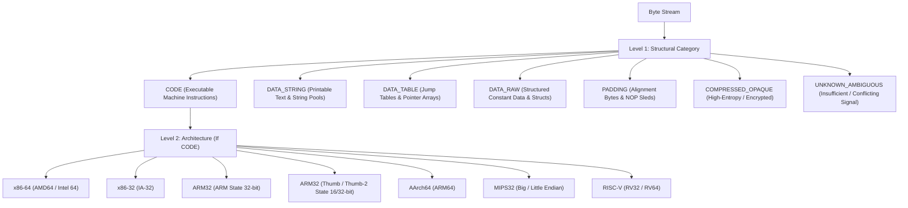

# Structural Label Taxonomy & Hierarchy

**Document Version:** 1.0.0  
**Project:** KETHRAVAX  
**Classification:** Annotation & Modeling Taxonomy  
**Date:** 2026-11-22  

---

## 1. Design Rationale

Earlier proposals in academic literature frequently suffer from two opposing flaws:
1. **Overly coarse binary classification:** Reducing all bytes to `CODE` vs `DATA` (e.g. ELISA, Remigio et al.). This obscures the critical distinction between string literals, jump tables, alignment padding, and compressed payloads.
2. **Overly fine-grained unlearnable taxonomy:** Attempting to classify 15+ sub-categories (e.g. distinguishing `.rodata` integers from `.data` floats from byte statistics alone). This forces the model to hallucinate distinctions that have identical byte distributions.

**KETHRAVAX adopts a scientifically grounded, hierarchical taxonomy** grounded in verifiable byte-level evidence.

---

## 2. Hierarchical Structural Taxonomy ($\mathcal{T}$)

---

## 3. Structural Categories Defined

### Class 0: `CODE` (Executable Machine Code)
- **Definition:** Contiguous byte ranges containing valid machine instructions for a supported CPU architecture.
- **Byte Evidence:**
  - Presence of architecture-specific instruction prologues/epilogues (e.g., `0x55 0x48 0x89 0xE5` for x86-64, `0xE92D4...` for ARM32).
  - Valid branch target offsets referencing offsets within the segment or nearby address space.
  - Typical instruction entropy ($H \in [5.2, 6.8]$ bits/byte).
  - Absence of large continuous runs of printable ASCII or pure zeros.

### Class 1: `DATA_STRING` (Text & String Literal Pools)
- **Definition:** Continuous sequences of human-readable text, string literal pools, format strings, error messages, and symbol tables.
- **Byte Evidence:**
  - High density (>80%) of printable ASCII (`0x20`–`0x7E`), tab (`0x09`), newline (`0x0A`, `0x0D`), or valid UTF-8 sequences.
  - Null-terminator delimiters (`0x00`) separating individual strings.
  - Distinct byte frequency distribution peaked around lowercase English characters (`0x61`–`0x7A`).
  - Low-to-moderate entropy ($H \in [3.5, 5.0]$ bits/byte).

### Class 2: `DATA_TABLE` (Structured Tables, Jump Tables, Pointer Arrays)
- **Definition:** Relocation tables, switch jump tables, virtual method tables (vtables), and aligned pointer arrays.
- **Byte Evidence:**
  - Repetitive 4-byte or 8-byte aligned numerical entries.
  - Clustered or monotonic virtual address ranges (e.g., consecutive pointers pointing to `.text` or `.rodata`).
  - High proportion of zero upper bytes in 64-bit pointers (e.g., `0x00 0x00 0x00 0x00` in little-endian 64-bit space).
  - Low entropy ($H \in [1.5, 4.2]$ bits/byte).

### Class 3: `DATA_RAW` (Structured Constant Data & Structs)
- **Definition:** Non-string constant structs, initialized configuration values, bitmap icons, and non-pointer numerical arrays.
- **Byte Evidence:**
  - Non-uniform, structured byte patterns not matching pure text or pointer tables.
  - Moderate entropy ($H \in [4.0, 6.5]$ bits/byte).

### Class 4: `PADDING` (Alignment & Fill Bytes)
- **Definition:** Inter-function alignment padding, page alignment fill, or NOP sleds.
- **Byte Evidence:**
  - Monotonically repeating single bytes: `0x00` (null padding), `0x90` (x86 NOP), `0xCC` (x86 int3), `0x00000000` or `0x0000a0e1` (ARM NOP).
  - Extremely low entropy ($H \in [0.0, 0.8]$ bits/byte).

### Class 5: `COMPRESSED_OPAQUE` (Compressed or Encrypted Streams)
- **Definition:** Compressed payloads (zlib, gzip, lzma, squashfs chunks) or encrypted data blobs.
- **Byte Evidence:**
  - High Shannon entropy ($H \ge 7.2$ bits/byte, approaching theoretical maximum 8.0).
  - Uniform byte frequency distribution passing chi-square tests for randomness.
  - Absence of repeating n-grams or pointer alignment.

### Class 6: `UNKNOWN_AMBIGUOUS` (Uncertain / Conflicting Signal)
- **Definition:** Regions where byte evidence is insufficient (e.g., short 8-byte fragments) or where conflicting signals prevent confident categorization.
- **Rule:** When the model's calibrated confidence drops below threshold $\theta_{\text{unknown}}$ (default 0.40), the segment is explicitly marked `UNKNOWN_AMBIGUOUS`.

---

## 4. Architecture Taxonomy ($\mathcal{T}_{\text{arch}}$)

When $\mathcal{C} = \text{CODE}$, the second-level classification assigns one of the following architectures:
1. `x86_64`: x86 64-bit (AMD64 / EM64T).
2. `x86_32`: x86 32-bit (IA-32).
3. `arm32_arm`: ARMv7/v6 32-bit ARM instruction state (fixed 32-bit width).
4. `arm32_thumb`: ARMv7/v6 Thumb/Thumb-2 state (mixed 16/32-bit width).
5. `aarch64`: ARMv8-A/v9-A 64-bit (fixed 32-bit width).
6. `mips32`: MIPS32 Big/Little Endian.
7. `riscv`: RISC-V (RV32I / RV64I).
8. `arch_unknown`: Code confirmed, but architecture is unresolvable or rare.

