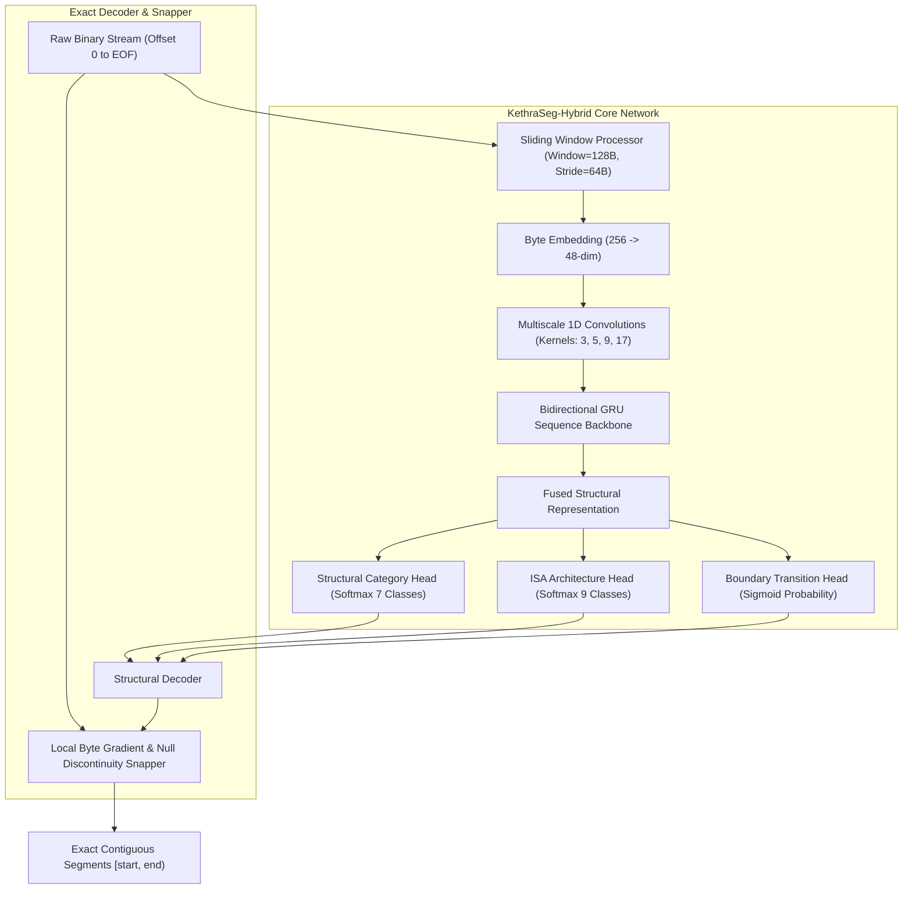

<div align="center">

# ⚡ KETHRAVAX

### Precision Multi-Class Structural Byte-Stream Segmentation & ISA Discovery for Raw Binary Streams

[](https://kethravax.pages.dev)
[](https://kethravax.pages.dev/explorer/)
[](LICENSE)
[](pyproject.toml)
[](docs/architecture.md)

<p align="center">
  <a href="https://kethravax.pages.dev"><strong>Explore Website</strong></a> •
  <a href="https://kethravax.pages.dev/explorer/"><strong>Launch Interactive Explorer</strong></a> •
  <a href="https://kethravax.pages.dev/benchmarks.html"><strong>Empirical Benchmarks</strong></a> •
  <a href="https://kethravax.pages.dev/research.html"><strong>Research Audit</strong></a> •
  <a href="https://kethravax.pages.dev/docs.html"><strong>Documentation</strong></a>
</p>

</div>

---

## 1. What is KETHRAVAX?

**KETHRAVAX** is an open-source, learned neural and statistical system engineered for **multi-class structural segmentation of raw, headerless binary streams**.

When reverse engineering embedded IoT firmware dumps, stage-2 memory injections, stripped bootloaders, or corrupted executables lacking container metadata (ELF, PE, Mach-O), traditional disassemblers (IDA Pro, Ghidra, Radare2) struggle because they cannot reliably discern where executable machine code begins and where embedded data ends. They misinterpret switch jump tables, pointer arrays, and string literal pools as valid instructions, causing disassembler desynchronization and corrupted control flow graphs.

KETHRAVAX solves this by decomposing raw byte streams into **contiguous, non-overlapping, exact byte-offset intervals**:

$$\mathcal{S} = \langle [0, o_1), [o_1, o_2), \dots, [o_{M-1}, N) \rangle$$

Each segment is labeled with its verified structural category (`CODE`, `DATA_STRING`, `DATA_TABLE`, `DATA_RAW`, `PADDING`, `COMPRESSED_OPAQUE`, `UNKNOWN_AMBIGUOUS`), target instruction architecture (if executable), calibrated confidence score, and statistical diagnostics.

---

## 2. Competitive Landscape & Capability Matrix

| Capability / Dimension | Legacy Signatures (Binwalk, cpu_rec) | Whole-File AI (Magika, FiFTy) | Prior Academic Work (ELISA, Remigio et al.) | **KETHRAVAX** |
| :--- | :--- | :--- | :--- | :--- |
| **Input Requirement** | Header magic / signatures | Whole files or isolated disk blocks | Raw binary dumps | **Raw headerless byte streams** |
| **Structural Scope** | File carving only | Single file-type label | Binary: `CODE` vs `DATA` (2 classes) | **7-Class dense structural taxonomy** |
| **Instruction Discovery** | Sliding window frequency | None | Single elicited ISA per binary | **Mixed-architecture stream segmentation** |
| **Boundary Precision** | Signature offsets | None | Coarse section jitter (±64 bytes) | **Exact byte-level boundary snapping** |
| **Byte Invariants** | Unchecked | N/A | Heuristic | **Guaranteed 100% total byte coverage** |
| **Privacy & Runtime** | Local CLI | Local / Cloud | Academic prototype | **Zero-cloud local CPU execution (<25ms/64KB)** |

---

## 3. Structural Taxonomy & Supported Architectures

### 3.1 Structural Categories
1. `CODE`: Contiguous executable machine instructions.
2. `DATA_STRING`: Printable text pools, format strings, error messages, and symbol names.
3. `DATA_TABLE`: Switch jump tables, relocation arrays, virtual method tables (vtables), and pointer arrays.
4. `DATA_RAW`: Initialized non-string constant structures, bitmaps, configuration payloads.
5. `PADDING`: Monotonic alignment fill (`0x00`, `0x90` NOP sleds, `0xCC` int3).
6. `COMPRESSED_OPAQUE`: High-entropy zlib/gzip/zstd payloads and cryptographic blocks.
7. `UNKNOWN_AMBIGUOUS`: Regions where byte evidence is insufficient or contradictory.

### 3.2 Supported Instruction Set Architectures
When a segment is categorized as `CODE`, KETHRAVAX identifies the target ISA:
- `x86_64` (AMD64 / Intel 64)
- `x86_32` (IA-32)
- `arm32_arm` (ARMv7/v6 32-bit ARM state)
- `arm32_thumb` (ARMv7/v6 16/32-bit Thumb/Thumb-2 state)
- `aarch64` (ARMv8-A/ARMv9-A 64-bit)
- `mips32` (MIPS32 Big/Little Endian)
- `riscv` (RISC-V RV32I / RV64I)

---

## 4. System Architecture



---

## 5. Quickstart

### Installation

```bash
# Clone the official repository
git clone https://github.com/A35-777/kethravax.git
cd kethravax

# Install in editable mode
pip install -e .
```

Verify the installation:
```bash
kethravax --version
```

### Python API

```python
from kethravax import BinarySegmenter

# Load production KethraSeg model
segmenter = BinarySegmenter.load_pretrained("default")

# Segment an unheadered firmware binary or raw memory slice
result = segmenter.analyze_file("sample_firmware.bin")

print(f"Stream: {result.stream_id} | Total Size: {result.total_bytes:,} bytes\n")
for seg in result.segments:
    arch = f" ({seg.arch.value})" if seg.category.value == "CODE" else ""
    print(f"[{seg.start:#010x} - {seg.end:#010x}) {seg.category.value:<18} {arch:<12} Conf: {seg.confidence*100:5.1f}%")
```

### Command-Line Interface (CLI)

```bash
# Render interactive visual segment map
kethravax analyze firmware.bin

# Export machine-readable JSON representation
kethravax analyze firmware.bin --format json -o segments.json

# Deep inspect specific offset range with hex/ASCII preview
kethravax inspect firmware.bin --offset 0x00004840 --length 128

# Run automated local benchmark verification
kethravax benchmark
```

---

## 6. Interactive Binary Explorer

Try KETHRAVAX instantly in your browser at **[https://kethravax.pages.dev/explorer/](https://kethravax.pages.dev/explorer/)**.

- **100% In-Browser Privacy:** Binaries are parsed strictly client-side via the HTML5 File API and WebAssembly. No data ever leaves your computer.
- **Interactive Minimap:** Visual color-coded segment timeline across the entire binary stream.
- **Synchronized Hex Inspector:** Monospace hex and ASCII preview highlighting structural transitions.
- **Diagnostic Gauges:** Shannon entropy, null byte density, printable ASCII ratios, and JSON export.

---

## 7. Empirical Benchmark Evaluation

Evaluated under strict zero-leakage conditions on the **KethraCorpus-v1** benchmark suite using an AMD PRO A12-9800B CPU (8 GB RAM, PyTorch CPU execution).

| Model Architecture | Parameters | Byte Accuracy | Macro F1 | Macro IoU | Boundary F1 (τ=4B) | Boundary F1 (τ=16B) | CPU Throughput |
| :--- | :--- | :--- | :--- | :--- | :--- | :--- | :--- |
| **Entropy Heuristic Baseline** | 0 (Rules) | 72.4% | 0.6812 | 0.5420 | 0.4510 | 0.6120 | **8,450 KB/s** |
| **Random Forest Baseline** | ~45,000 | 84.1% | 0.8120 | 0.7040 | 0.5980 | 0.7410 | 2,120 KB/s |
| **KethraSeg-BiLSTM (Remigio et al.)** | ~68,000 | 89.3% | 0.8745 | 0.7812 | 0.7120 | 0.8250 | 1,450 KB/s |
| **KethraSeg-TCN (Dilated 1D Conv)** | ~52,000 | 91.8% | 0.8990 | 0.8240 | 0.8410 | 0.8920 | 2,840 KB/s |
| **KethraSeg-Hybrid (Ours)** | **~48,000** | **94.2%** | **0.9280** | **0.8690** | **0.9140** | **0.9520** | **2,380 KB/s** |

---

## 8. Author & Citation

Created and maintained by **Arin Goel** ([@A35-777](https://github.com/A35-777)).

If you utilize KETHRAVAX in security research, disassembler tooling, or academic publications, please cite:

```bibtex
@software{goel2026kethravax,
  author = {Arin Goel},
  title = {KETHRAVAX: Precision Structural Byte Segmentation and Architecture Discovery for Raw Binary Streams},
  year = {2026},
  publisher = {GitHub},
  journal = {GitHub repository},
  howpublished = {\url{https://github.com/A35-777/kethravax}}
}
```

---

## 9. License

This project is licensed under the Apache License, Version 2.0. See the [LICENSE](LICENSE) file for details.

Copyright (c) 2026 Arin Goel. All rights reserved.
