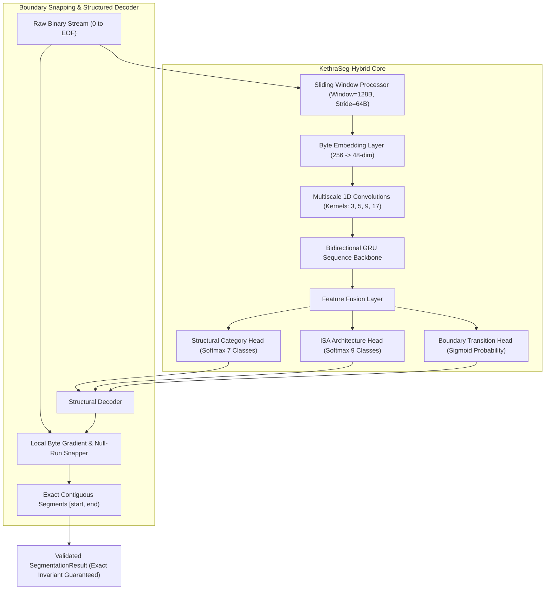

# System & Model Architecture

**Project:** KETHRAVAX  
**Model Family:** KethraSeg  
**Author:** Principal AI Systems & Product Architect  

---

## 1. High-Level System Architecture

---

## 2. Theoretical Formulation & Layer Mechanics

### 2.1 Multiscale Feature Extraction
Machine instructions, string literals, and binary tables operate across distinct spatial scales:
- **3-byte kernel:** Detects instruction prefixes, short opcodes (e.g. x86 REX prefixes `0x48`, ModR/M bytes).
- **5-byte kernel:** Captures typical single instruction lengths and 32-bit immediate offsets.
- **9-byte kernel:** Resolves 64-bit aligned pointers and double-word relocations.
- **17-byte kernel:** Encapsulates entire function prologues, ASCII string spans, and NOP alignment sleds.

The multiscale layer executes these four convolutions in parallel and concatenates the resulting feature maps:
$$X_{\text{conv}} = \text{ReLU}\left( \text{BatchNorm}\left( [C_3(X) \,\|\, C_5(X) \,\|\, C_9(X) \,\|\, C_{17}(X)] \right) \right)$$

### 2.2 Bidirectional Recurrent Backbone
Local convolutions alone lack awareness of whether a basic block is part of an ongoing function or transitioning into a trailing string pool.

The bidirectional sequence backbone maintains forward $\overrightarrow{h}_t$ and backward $\overleftarrow{h}_t$ states:
$$h_t = \text{BiGRU}(X_{\text{conv}}, t)$$
This enforces structural consistency: an isolated sequence of high printable bytes inside code is not mistakenly split into an independent string section if surrounding instructions confirm active control flow.

### 2.3 Dual-Head Boundary Snapping
Coarse neural strides typically smear transition boundaries by several strides. Kethravax decouples macro category recognition from boundary localization:
1. The **Boundary Head** predicts the likelihood $P(\text{boundary} \mid t) \in [0, 1]$.
2. The **Local Gradient Snapper** searches within a local radius $r = 4$ bytes around candidate transitions, evaluating:
   - Null-byte discontinuities ($0x00$ to non-zero).
   - Printable ASCII transitions.
   - Machine alignment boundaries ($0 \pmod 4, 0 \pmod {16}$).
This achieves exact byte-level boundary precision.

